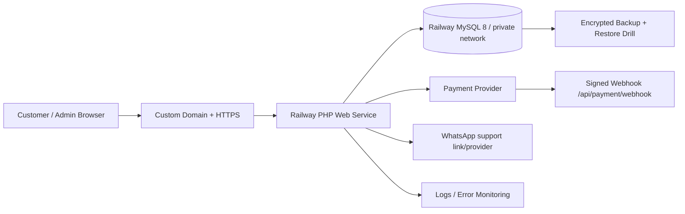

# Geo Booster — Deployment Architecture

## Executive decision

Untuk fase MVP dan tim kecil, gunakan:

```text
GitHub
  ↓
Railway Web Service (PHP 8.3 + Apache)
  ↓ private network
Railway MySQL 8
  ↓
Payment provider / WhatsApp / monitoring
```

Vercel yang saat ini menyajikan static catalog tetap bisa dipakai sebagai preview atau landing page sementara. Untuk sistem production yang memiliki login admin, database, webhook payment, dan session, canonical app sebaiknya dijalankan sebagai **PHP web service**, bukan static file proxy.

### Mengapa MySQL 8

- Schema Geo Booster dan migration saat ini sudah menggunakan MySQL/MariaDB.
- PDO MySQL sudah sesuai dengan PHP app yang ada.
- Tidak perlu melakukan migrasi SQL ke PostgreSQL pada saat yang sama dengan pembangunan auth/admin/payment.
- Relational transaction, foreign key, unique webhook event, dan audit log cocok untuk domain commerce ini.
- Railway menyediakan MySQL service dengan variable `MYSQLHOST`, `MYSQLPORT`, `MYSQLUSER`, `MYSQLPASSWORD`, `MYSQLDATABASE`, dan `MYSQL_URL`.

### Mengapa Railway untuk MVP

- PHP app dapat dijalankan sebagai container Docker.
- MySQL dapat diprovision dalam project yang sama.
- Service internal dapat memakai private networking.
- Environment variable dapat direferensikan antar-service.
- Satu project cukup untuk web service dan database pada tahap awal.

Railway MySQL tetap perlu diperlakukan sebagai database yang harus dioperasikan: backup, point-in-time recovery, monitoring, dan restore drill wajib diaktifkan sebelum payment production. Railway sendiri menyatakan template MySQL-nya adalah deployment dari official MySQL Docker image dan unmanaged; owner tetap bertanggung jawab atas operasionalnya.

## Provider comparison

| Option | Fit untuk Geo Booster sekarang | Kelebihan | Kekurangan/keputusan |
|---|---|---|---|
| Railway PHP + MySQL | **Recommended MVP** | Cocok dengan schema sekarang, setup sederhana, private service networking | MySQL template perlu backup/ops yang disiplin |
| Render PHP + Postgres | Cocok jika memilih Postgres dari awal | Managed Postgres, internal URL, PITR pada paid plan | Perlu rewrite seluruh migration dan PDO DSN ke PostgreSQL |
| Supabase/Neon Postgres + PHP host | Cocok untuk architecture Postgres | Managed Postgres dan tooling bagus | Menambah provider, network/connection management, serta migrasi SQL |
| Vercel static | Hanya public catalog | CDN dan delivery cepat | Bukan runtime PHP/database untuk admin dan webhook |
| Shared PHP hosting + MySQL | Budget rendah | Familiar untuk PHP | Deployment, secret management, backup, observability, dan rollback biasanya lebih lemah |

**Keputusan:** jangan melakukan database migration ke PostgreSQL sekarang. Re-evaluasi setelah product-market fit atau kebutuhan analytics/read replica muncul.

## Production topology



## Repository deployment layout

```text
php-app/
  Dockerfile
  docker/000-default.conf
  public/                 # Apache document root
  app/                    # PHP application code
  config/                 # non-secret config only
  database/               # migrations, seed, rollback
  bin/                    # migration and owner provisioning
```

`config/`, `database/`, `app/`, `storage/`, and `.env` must not be directly served by Apache.

## Railway setup checklist

### 1. Create project

1. Create a Railway project from the GitHub repository.
2. Add a MySQL service using Railway's MySQL template.
3. Add a web service from the same repository.
4. Set the web service root directory to `php-app` if Railway asks for a service root.
5. Railway detects `php-app/Dockerfile` when the service root is `php-app`.

### 2. Configure variables

Set application variables on the PHP service:

```text
APP_ENV=production
APP_URL=https://your-domain.example
APP_KEY=<random-long-secret>
DB_DSN=mysql:host=${{MySQL.MYSQLHOST}};port=${{MySQL.MYSQLPORT}};dbname=${{MySQL.MYSQLDATABASE}};charset=utf8mb4
DB_USERNAME=${{MySQL.MYSQLUSER}}
DB_PASSWORD=${{MySQL.MYSQLPASSWORD}}
SESSION_NAME=geo_booster_session
SESSION_SECURE_COOKIE=true
ADMIN_ENABLED=true
PAYMENT_PROVIDER_SECRET=<only-after-provider-approval>
```

Use Railway's reference-variable syntax for the actual service name. Never paste database passwords into GitHub, README, tickets, screenshots, or chat.

### 3. Deploy and migrate

Run migration from a one-off Railway shell/job attached to the web service image:

```bash
cd /var/www/html
php bin/migrate.php up
php bin/migrate.php seed
php bin/create-owner.php owner@example.com "Geo Booster Owner"
```

The owner password must be entered interactively or through a protected one-time operational session. Do not put it in a deploy command or environment variable that is logged.

### 4. Verify

```bash
curl -I https://your-domain.example/
curl -I https://your-domain.example/admin/
```

Expected:

- Public catalog: `200`.
- Admin without session: login page or safe database-unavailable page.
- Admin mutation without CSRF: `419`.
- Unauthorized role: `403`.
- No `.env`, SQL, config, or storage file is publicly readable.

## Domain strategy

### MVP

Use one canonical domain:

```text
https://geo-booster.example/          public catalog
https://geo-booster.example/admin/    internal admin
```

Protect `/admin/` with application auth and, if available, an additional IP allowlist or access policy. Do not expose a separate admin subdomain as a substitute for authorization.

### Later scale

```text
www.geo-booster.example       public catalog
admin.geo-booster.example    admin console
api.geo-booster.example      API/webhook
```

Split only when traffic, team ownership, or security boundary justifies the operational cost.

## Database operations

Before payment production:

- Automated daily encrypted backups.
- Point-in-time recovery where the provider supports it.
- Monthly restore drill to a separate database.
- Least-privilege application DB user.
- Separate migration/owner-provisioning operator credentials.
- Slow-query and connection monitoring.
- Alert on disk, CPU, memory, connection saturation, and failed backups.
- No customer credentials or product secrets in ordinary tables.

## Release sequence

```text
1. Deploy PHP container with payment disabled
2. Provision MySQL and run migrations
3. Provision owner and activate MFA
4. Import products as compliance=pending
5. Verify admin catalog and audit trail
6. Enable inquiry/order creation
7. Add one payment provider sandbox
8. Test signed webhook and duplicate replay
9. Enable production payment for allowlisted users
10. Monitor and expand gradually
```

## What not to do

- Do not use Vercel static export as the admin/payment backend.
- Do not expose Railway MySQL publicly unless there is a documented operational reason.
- Do not migrate MySQL to Postgres during the payment implementation unless there is a strong requirement.
- Do not enable `ADMIN_ENABLED=true` without HTTPS, MFA, and database backup.
- Do not enable payment live before business/compliance and refund policy are approved.

## Senior engineering recommendation

Build a **modular monolith**, not microservices:

```text
PHP application
  ├── Auth/RBAC
  ├── Catalog
  ├── Orders
  ├── Payments adapter
  ├── Fulfillment
  ├── Audit
  └── Notifications
```

Keep clear module boundaries and interfaces. Extract a worker or service only after measured load, queue latency, or team ownership makes the split necessary. This is the highest-leverage L8 decision for the current business stage: reduce operational complexity while preserving future seams.

## References

- Railway MySQL documentation: https://docs.railway.com/databases/mysql
- Render Postgres documentation: https://render.com/docs/postgresql-creating-connecting
- Neon PHP/PDO documentation: https://neon.com/postgresql/php/connect
- OWASP ASVS: https://owasp.org/www-project-application-security-verification-standard/
- Twelve-Factor App: https://12factor.net/
